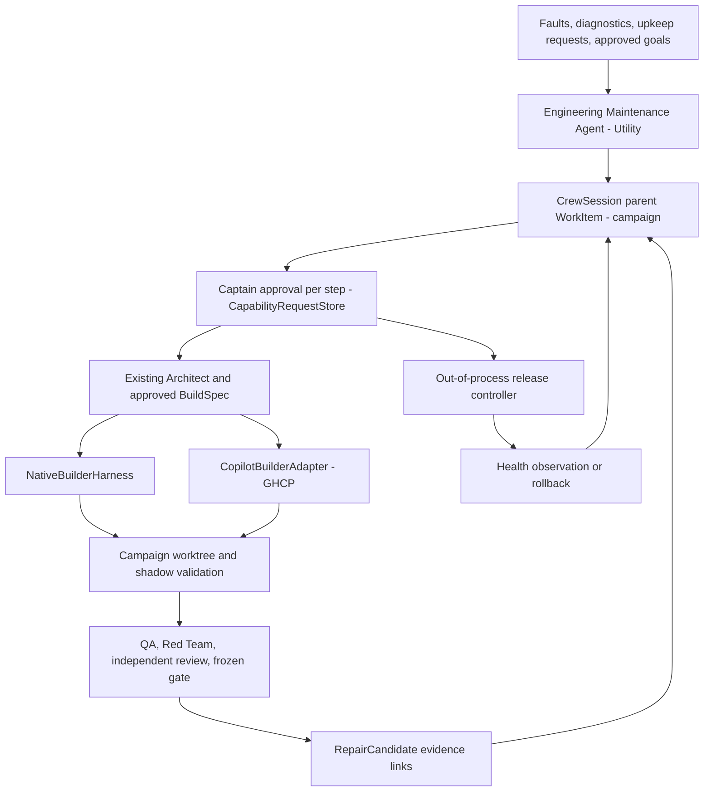

# AD-1299 - ProbOS Self-Maintenance Architecture

**Status: planned, not implemented.** This is an OSS architecture decision, not
an active repair campaign or permission to start one. No runtime, deployment,
governance policy, or campaign state changes are authorized here.

> **Rescope 2026-10-11 (native owners).** The Captain retired the Supervised
> Worker integration on 2026-10-10. This document now names native ProbOS owners
> for campaign state, authority, review, execution backends and release. The
> requirements that stood (separate grants, isolated build, independent review,
> immutable promotion, verified rollback, no in-place patching) are unchanged.
> One decision is **parked** for the Captain (D-B2: OS-enforced isolation, which
> delegated and autonomous grants need); S1-S4 proceed with Captain-per-step
> authority. Recorded in the append-only
> [decision record](../../DECISIONS.md#ad-1299-2026-09-06---governed-probos-self-maintenance)
> under "Native rescope (2026-10-11)".

**Tracking:** [Epic #1352](https://github.com/seangalliher/ProbOS/issues/1352).
See the [roadmap](roadmap.md#probos-self-maintenance-ad-1299) and the append-only
[decision record](../../DECISIONS.md#ad-1299-2026-09-06---governed-probos-self-maintenance).

## Purpose and boundary

A Utility-tier **ProbOS Engineering Maintenance Agent** diagnoses, repairs,
maintains, and enhances ProbOS by composing its existing engineering and
self-modification systems. It is an instructions-first `CognitiveAgent`, not
another coding loop, scheduler, or root of trust. Its proposed implementation
name is `EngineeringMaintenanceAgent`; this document does not claim that class
is already implemented.

**Governance is native and honest about its strength.** Campaign identity and
lifecycle live in the existing CrewSession/WorkItem owners; authority is the
Captain's decision on an action-shaped approval, bound to one candidate digest,
per consequential step; release activation is an out-of-process controller the
Captain invokes. ProbOS cannot authorize its own promotion: it holds no
promotion entry point.

**What is enforced and what is only detected.** Enforced: a human decision at
every consequential step, compare-and-set state transitions in the existing
stores, a controller process that does not depend on ProbOS being alive, and
generation-checked activation and rollback. Refused: a receipt or review set
that contradicts the candidate in the facts the binders check (commit, tree,
status, schema and reviewer independence, plus the label when one is
expected). Recorded, not refused: a sha256 for each piece of evidence; for a
receipt, the SHA-256 of the supplied raw bytes, so any change to those bytes
changes it; for a review set, a domain-separated SHA-256 of the
candidate-bound projection of five review fields (attempt id, reviewer id,
assignee id, reviewed tree, accepted), so a change to those five fields
changes it and a change to any other review attribute does not. A consumer
that retained an earlier trusted digest can therefore detect a change within
what each digest covers. Not authenticated: the evidence's producer; unread
fields are not asserted valid. Not prevented: writes by any process that runs
under ProbOS's own OS identity to ProbOS state, the release root or the
evidence (AD-1315 Boundary: local-host evidence, not a defense against
administrator/root/kernel compromise). Excluding same-identity writers needs a
separate owner identity or OS isolation with privileged provisioning; that is
the parked D-B2 decision.

## Existing foundations and measured limits

These are inspected source contracts, not a claim that a running vessel has
exercised the proposed end-to-end path.

| Foundation | Reuse and boundary |
|---|---|
| [EngineeringAgent](../../src/probos/cognitive/engineering_officer.py) | The existing Domain-tier Engineering officer provides analysis and optimization proposals. Keep that role and the chain of command; the new Utility agent owns the scoped maintenance-facing cognitive lifecycle, not department leadership. |
| [RepairBrief](../../src/probos/cognitive/repair_brief.py) and [RepairDispatcher](../../src/probos/cognitive/repair_dispatch.py) | AD-1172 already carries a harness-neutral brief and files one action-shaped Captain approval (`REPAIR_ACTION = "dispatch"`, `capability_request.py:116`) without running a harness. Reuse its fault identity, brief, and approval surface; do not add a parallel fault store or target chooser. |
| [Repair verification](../../src/probos/cognitive/repair_verification.py) | The existing verifier labels a changed error signature `repaired` even when the operation still fails (lines 242-248). Preserve that fault-specific meaning; it is not acceptance evidence for the requested behavior or runtime promotion. |
| [CrewSessionService](../../src/probos/cognitive/crew_session.py) and the WorkItem store ([workforce.py](../../src/probos/workforce.py)) | AD-1124..1128: durable parent/child work, owned steps, `open_or_resume` (`crew_session.py:3529`), `compare_and_set_recovery` (:5593), effect-attempt claims (`workforce.py:3985`), verification CAS (:9608), terminal transition with trust (:10002). The native owner of campaign identity and lifecycle. |
| [Owned-step review records](../../src/probos/work_item_steps.py) | `ReviewedStepResult` (`work_item_steps.py:506`) carries submission digest, reviewer and review attempt; reviewer must differ from assignee (lines 460, 609; `workforce.py:3509`). The native owner of independent-review provenance. |
| [Chain-of-command approvals](../../src/probos/delegated_approvals.py) and [ApprovalAuthorityStore](../../src/probos/approval_authority.py) | AD-1213: every `action` request stays with the Captain alone (`delegated_approvals.py:12-13`); authority records cannot exist without `expires_at` (`approval_authority.py:62`). |
| [ProtectedExecutionAuthority](../../src/probos/execution/authority.py) and [GovernedEffectBroker](../../src/probos/execution/effect_broker.py) | AD-1315/AD-1316: manifests, generations, grants, operation/attempt identity, `unknown`/`blocked` states and reconciliation. Default OFF (`ProtectedExecutionConfig.enabled=False`, `profile="ordinary"`, `effect_broker_enabled=False`). Records evidence; governs only `ToolExecutor`/`ToolRegistry` calls. Not campaign state (AD-1316: the broker owns "not ... campaign state"). |
| [ArchitectAgent](../../src/probos/cognitive/architect.py) | Grounded engineering proposals. Retain its existing role; adding a Utility maintenance agent does not reclassify the Architect. |
| [Builder and execute_approved_build](../../src/probos/cognitive/builder.py) | Existing `BuildSpec` and build execution (`builder.py:2629`). The helper writes into the supplied `work_dir`; its branch creation does not establish runtime isolation. Its embedded code review ([CodeReviewAgent](../../src/probos/cognitive/code_reviewer.py)) is a soft gate, not independent review. |
| [NativeBuilderHarness](../../src/probos/cognitive/swe_harness/native_builder.py) | Existing ProbOS coding harness (`run_build(spec, work_dir)` returns `file_changes`, line 103). Its tools run through `ToolExecutor`, so the AD-1316 broker can govern them when strict mode is on. A directory named in a prompt does not confine tools. |
| [CopilotBuilderAdapter](../../src/probos/cognitive/copilot_adapter.py) | Existing GHCP backend (`execute` returns `CopilotBuildResult.file_blocks`). Runs with `PermissionHandler.approve_all` (line 510); its tools run inside the Copilot SDK, outside `ToolExecutor`, so the broker never sees them. |
| [SelfModificationPipeline](../../src/probos/cognitive/self_mod.py) | Reuse design, validation, sandbox, probationary trust, and behavioral monitoring through injected dependencies. Maintenance candidates must bind registration and pool creation to the shadow runtime, never the active runtime. |
| [CodeValidator](../../src/probos/cognitive/code_validator.py) | Validates generated agent source, including agent-schema conformance. It is not a general validator for arbitrary runtime modules and is not a substitute for isolation or repository gates. |
| [SystemQAAgent](../../src/probos/agents/system_qa.py) and [RedTeamAgent](../../src/probos/agents/red_team.py) | Reuse QA and adversarial checks with campaign-bound inputs and results. Merely registering an agent or producing a verdict does not prove the candidate was tested. |
| [TrustNetwork](../../src/probos/consensus/trust.py) and [episodic memory](../../src/probos/cognitive/episodic.py) | Learn from verified attempted outcomes; neither a high trust score nor a remembered lesson grants authority. |
| [Repository test gate](../../scripts/run_test_gate.py) | Reuse the canonical frozen-tree validation and receipts. A success receipt binds `tree.head`, `tree.head_tree` and `tree.index_tree` and is refused for an uncommitted index (lines 1659-1676). A harness exit or a selected subset is not the broad gate. |

The closed [self-diagnosis and repair epic #1095](https://github.com/seangalliher/ProbOS/issues/1095)
owns AD-1166 through AD-1173. Its closure records the shipped fault/diagnose/repair
loop; its original problem statement is historical, not a current absence
claim. AD-1299 extends those foundations with governed campaigns and immutable
runtime promotion rather than reopening or duplicating them.

**Measured gaps.** There is no promotion or rollback step in the native repair
loop and no release, updater, promotion or rollback module for ProbOS builds
(`startup/rollback.py` unwinds a failed start; `turn_promotion.py` promotes
conversational turns). `verify_and_close` has no production caller.
`FaultReportStore.resolve` (`fault_report.py:909`) has no expected-state check,
and when its database write fails it logs and keeps the new status in its cache.
`/api/health` (`routers/system.py:35`) reports liveness but no release identity.

**Existing paths that patch the running checkout (constraint).**
`WorktreeManager.merge_to_main` checks out `main` and merges in the repository
root (`worktree_manager.py:143-169`), reached through
`BuildDispatcher.approve_and_merge` and `routers/build.py:158`;
`WorktreeManager.remove` uses `worktree remove --force` and `branch -D`
(`worktree_manager.py:105,112`); `routers/build.py:60` builds with the repository
root as `work_dir`. **AD-1299 work must never route through them.** A separate
BF is recommended; it is not filed by this rescope.

## Design references from the retired Supervised Worker Doctor

The retired Doctor solved three problems this epic also has. They are carried
as **ideas, not code**; nothing is copied, ported, imported or wrapped. Each is
mapped to its native owner so the epic does not grow a second campaign engine.

- **(a) Isolated repair with verified promotion and rollback.** Each attempt in
  its own worktree with its own identity; preserve operator work; never force
  cleanup; promote only a clean committed tree into a new immutable install;
  compare-and-set activation; inspect, never replay, a lost reply; roll back only
  if the active generation still matches; an unknown rollback blocks. Native
  owner: S3 (campaign worktrees) and S4 (release controller). Net-new work.
- **(b) Typed incident and rescue records.** Versioned typed records with
  expected-state transitions; `unknown` is terminal until reconciled; budgets
  bound attempts. Native owner: the fault and filing owners (`FaultReport`,
  `fault_issue_filings`), CrewSession/WorkItem lifecycle, and AD-1316's
  operation/attempt identity. No second incident store or state machine.
- **(c) A campaign evidence bundle.** Link already-recorded evidence for one
  candidate to the exact commit and tree; grants no authority; missing proof
  stays explicitly unavailable. Native owner: the S1 `RepairCandidate` and
  evidence-link contract, reusing the gate receipt rather than re-deriving it.

## Ownership and cognitive lifecycle

- **Perceive:** read scoped diagnostics, existing fault records, source/test
  evidence, and relevant episodes. Resolve operational paths and release identity
  from the process/deployment authority, never from a repository-relative guess.
- **Decide:** use instructions-driven reasoning to diagnose, classify the work,
  choose an existing engineering capability, and propose a bounded objective.
  An agent's classification is a proposal; the Captain's approval is authority.
- **Act:** obtain an Architect-reviewed contract, open the campaign as a
  CrewSession, request each consequential step through the existing approval
  surface, and collaborate with Builder, QA, and Red Team within the admitted
  campaign. Deterministic services own transitions; agents own engineering
  judgment (Design Principle #1).
- **Report:** project campaign evidence into existing work/approval surfaces and
  episodic memory. Distinguish proposed, built, tested, promoted, healthy, rolled
  back, blocked, failed, and unknown outcomes. A report or a work-item status is
  not campaign completion; completion is the linked evidence chain below.

No second durable campaign database or scheduler is introduced. New
dependencies use narrow injected protocols; eventual configuration belongs in
the existing Pydantic models. Autonomous repair, maintenance, and enhancement
admission default to disabled. When an owner is unavailable, diagnosis and
proposals remain available; mutation and promotion are blocked with an explicit
escalation to the Captain, never a silent refusal (Design Principle #13).

## Separate authority classes

| Class | Permitted objective | Required authority |
|---|---|---|
| Repair | Restore an existing approved behavior against a reproduced defect and a discriminating regression test. | Captain approval per consequential step. An explicit time-bounded repair delegation (repository, paths, tools, risk, budgets, allowed effects fixed in advance) **waits for D-B2**. No feature expansion. |
| Maintenance | Preserve approved behavior through declared upkeep, supported dependency refresh, performance work, or bounded operational maintenance. | A separate maintenance grant with compatibility criteria, allowed operations, schedule, and resource limits. A repair grant does not imply it. A scheduled (unattended) grant **waits for D-B2**; until then each maintenance campaign is Captain-approved per step. |
| Enhancement | Add or intentionally change behavior, capability, public contracts, or architecture. | Explicit Captain-approved scope and architecture decision, followed by its own accepted build contract. Neither repair nor maintenance authority implies enhancement authority. |

Authority is checked at admission and every consequential boundary. Expiry,
revocation, scope drift, mixed-class changes, or an unclassified effect pauses
work for reauthorization; changing a label never widens a grant. Security,
governance, deployment-control, and data-migration effects require explicit
approval regardless of the proposed class. Destructive mesh intents retain
consensus requirements; consensus and trust do not replace Captain approval.

The agent, Builder, and either backend cannot be granted authority to change
approval rules, grants, review requirements, completion criteria, accepted
evidence, or the release controller. Changes to the release controller itself
are ordinary enhancements under their own Captain-approved AD and review; a
campaign cannot weaken the controls judging it. Under the in-envelope design
this is enforced by the Captain's per-step decision; recorded evidence digests
let a change be detected by a consumer holding an earlier trusted digest; it is
not an OS-level write exclusion (D-B2).

## Native campaign governance

Replaces the withdrawn `SupervisedCampaignAdapter` v1. There is no adapter and
no external campaign service: each requirement has a native owner.

| Contract area | Native owner and v1 semantics |
|---|---|
| Identity | A repair campaign is one CrewSession parent WorkItem; its id is the campaign key. Each repair attempt is an owned step with its own attempt identity. Backend identity is attempt metadata, never the campaign key. Repository, base commit and candidate identity are the S1 `RepairCandidate`. |
| Lifecycle | CrewSession/WorkItem compare-and-set transitions (`compare_and_set_recovery`, `transition_work_item`, verification CAS, terminal transition with trust). Effects an attempt produces use AD-1316 operation/attempt identity; `unknown` is terminal until reconciled and is never replayed. |
| Authority | The Captain's decision on an action-shaped request in `CapabilityRequestStore`, bound to the candidate digest, with an expiry, re-checked at each boundary. `action` requests stay with the Captain alone. Delegated/autonomous grants wait for D-B2. |
| Candidate | `RepairCandidate`: base commit, candidate commit, tree, and the reviewed index tree, which must equal the committed tree. A path or branch name alone is not candidate identity. |
| Evidence | Insert-only evidence links keyed by the candidate digest: gate receipt, review set, Captain approvals, promotion and health observation. Each link is `present`, `refused` (contradicts the candidate) or `unavailable` (cannot be read); anything other than `present` blocks completion and is never inferred. No raw prompts, credentials, or tool payloads in evidence. |
| Recovery | Reconcile before retry or backend switch, through CrewSession recovery and AD-1316 reconciliation. Duplicate submissions resolve to the existing operation; no transport-level exactly-once claim. |
| Results | Distinguish admitted, in progress, blocked/unknown, failed/cancelled, completed and rolled back. Acknowledgement is not execution, execution is not promotion, and a backend's success flag cannot close a campaign. |

**Enforced, refused, recorded (repeated because it is load-bearing).**
Enforced: the Captain decides each consequential step; store transitions are
compare-and-set; review records refuse a reviewer equal to the assignee.
Refused by the S1 binders: a receipt or review set that contradicts the
candidate in the facts they check (commit, tree, status, schema and reviewer
independence, plus the label when one is expected). Recorded: a sha256 per
piece of evidence. A receipt's covers its supplied raw bytes, so any change to
them changes it. A review set's covers only the candidate-bound projection of
five review fields (attempt id, reviewer id, assignee id, reviewed tree,
accepted): a change to those changes it, a change to any other review
attribute (for example a submission digest) does not. A consumer that retained
an earlier trusted digest can detect a change only within what each digest
covers; an edit to an unread receipt field, or a review re-labelled to another
valid independent value, still binds. Not authenticated and not prevented: the
producer's identity, and same-OS-identity writes to stores or evidence. Never
write "the candidate cannot write X", "every edit is refused" or "the digest
covers the whole review" where the platform only records what it records.

## Execution backends: one handoff

Replaces the Worker-dispatched backend model. Both backends already exist and
already share one native handoff: a `BuildSpec` goes in, a list of file changes
comes out, and `execute_approved_build(work_dir=<campaign worktree>)` applies it.

- **Native:** `NativeBuilderHarness.run_build(spec, work_dir)` returns
  `file_changes`. Tool calls pass through `ToolExecutor`, which AD-1316 can
  govern in strict mode.
- **GHCP:** `CopilotBuilderAdapter.execute` returns `file_blocks`. Its tools run
  inside the Copilot SDK with `approve_all`, outside `ToolExecutor`. A GHCP
  attempt is labelled **tools not confined, not broker-governed**; it requires a
  per-attempt Captain approval and is never eligible for a delegated grant.

Backend choice must not change **campaign identity, authority, review, evidence,
completion, promotion, or rollback semantics**. Every backend output is a
provisional proposal that ProbOS validates, commits in the campaign worktree and
identifies by tree hash. GHCP-authored candidates still pass CodeValidator (where
applicable), QA, Red Team and independent review. No backend-specific waiver.

A switch keeps the campaign, operation identity, budgets and history. The prior
attempt is reconciled first; an unknown attempt blocks automatic fallback. Only
evidence for the exact unchanged candidate can remain current.

**Dual-backend support is claimed only after a real GHCP run** of the milestone.
Conformance fixtures with a fake SDK prove the handoff, not the backend.

## Isolate, validate, promote, recover

1. **Pin and isolate.** Record the approved base and active release identities.
   Create a campaign worktree and constrained execution environment. Preserve
   existing worktrees and uncommitted changes; never force-remove, reset or stash.
   No backend may be given write access to the active runtime tree, environment,
   packages, data, governance state, or deployment selector. Check canonical
   paths, junctions/symlinks, hard links, subprocess working directories, and
   tool roots. A worktree is isolation of source changes, not a sandbox for
   arbitrary build/test code. Never route through `merge_to_main`,
   `WorktreeManager.remove` or the repository-root `work_dir` of
   `routers/build.py`.
2. **Diagnose and build.** Reuse the existing fault/repair flow, Architect and
   `BuildSpec`, then the native harness or GHCP against the campaign worktree.
   Assert the reproduction's premise before trusting it. Bind every mutation to
   the accepted footprint. No active-runtime `AgentPatcher`, monkey-patching,
   module reload, live registration, or in-place package update is a
   maintenance deployment path.
3. **Shadow validation.** Run a separate candidate process with disposable or
   verified snapshot-derived data, separate ports/identities, and blocked or
   explicitly brokered external effects. Prove interpreter/import origins are
   the candidate, not the parent's editable installation. Apply `CodeValidator`
   before every generated/restored agent import, retain sandbox/probation/QA/
   behavioral checks, and use repository static/security checks for core code.
   Do not weaken agent-schema validation to make arbitrary core modules pass.
   Replaying stored failing arguments requires authority for the operation's
   effects and an isolated target; a trace is not permission to repeat a live
   destructive action. Test the intended behavior, not just disappearance of
   the original error signature.
4. **Freeze and verify.** Run focused regressions through affected production
   consumers, then System QA and Red Team as owned-step reviews
   (`ReviewedStepResult`), each by an agent and context different from the
   builder's, plus the Captain's change approval. Repair findings, commit, then
   run the final canonical repository gate. Every review record and the gate
   receipt must name the same tree, equal to the receipt's `tree.head_tree` and
   `tree.index_tree`; the S1 evidence links refuse anything else. The Builder's
   internal `CodeReviewAgent` check is never relabelled as independent review.
   Any source, test, dependency, configuration, or artifact change invalidates
   affected evidence. No unresolved Critical/High finding and no missing/unknown
   required check can pass.
5. **Prepare immutable release.** Produce a content-addressed release manifest
   binding source tree, executable artifacts, locked dependencies, relevant
   configuration, the evidence-link digest, and the prior known-good release.
   Verify the staged bytes again before activation. Retain the previous release
   and a verified recovery path. Irreversible migrations are outside ordinary v1
   admission; data-affecting work needs an explicitly approved compatibility and
   restoration proof.
6. **Promote externally.** An out-of-process release controller (a
   standard-library script under `scripts/`) activates a release only on an
   explicit Captain command; the Captain running it is the authorization. It
   journals intent (append-only, fsynced), checks the expected active
   generation, and switches an atomic selector (temporary file plus
   `os.replace`) or performs a controlled restart. It never overwrites files a
   running process imported. ProbOS, the Builder and either backend hold no
   promotion entry point. The controller works while ProbOS is stopped. Moving
   the Captain's own launch onto the selector is an opt-in deployment change the
   Captain makes.
7. **Observe and roll back.** The controller observes `/api/health`, extended in
   S4 to report the active release identity, plus readiness, the targeted
   repaired behavior, and observation criteria fixed before promotion. Missing
   or ambiguous health is not healthy. On failure the controller restores the
   prior immutable release, only if the active generation still matches, and
   verifies its health; a changed generation or an unknown rollback outcome
   blocks and escalates. Code rollback is not data rollback: prohibit automatic
   reuse of incompatible data and escalate when the approved restore procedure
   cannot safely run. Recovery does not depend on ProbOS being healthy or
   running.

**Completion requires the chain**, not its individual producers: accepted
contract, isolated build, current validation and independent review, verified
immutable promotion, and passed post-promotion observation, each a `present`
evidence link for the same candidate. Any required remote publication and issue
closure must also be read back from their authorities. Rolled back is a recorded
outcome, not a successful enhancement. Keep campaign completion separate from
build success and from restoring service after failure.

Record diagnoses, attempted actions, reviewer findings, verification outcomes,
promotion, and rollback as linked episodes with evidence references. Trust
updates retain raw `(alpha, beta)` parameters and are idempotent over verified
attempted outcomes; no-attempt/blocked outcomes do not earn success credit.
Lessons, Hebbian routing, and behavioral monitoring can improve future proposals
but cannot modify authority or waive future gates.

## Parked: D-B2 (needs the Captain)

**Decision required:** admit privileged OS isolation (a separate owner identity
or isolation for the release root, controller and campaign state, provisioned
with privilege) as the precondition for delegated or autonomous repair and
maintenance grants. Ranked options: (1) admit it as a separate infrastructure
AD; (2) keep v1 Captain-per-step permanently; (3) accept detection-only
delegation (not recommended: it weakens a stated control). Envelope clauses:
weakens or provisions a security control; operation on the live host.

**Resumption condition:** the Captain chooses an option, and for option 1 the
isolation AD has landed. **Unbuildable until then:** delegated repair grants,
scheduled maintenance grants, autonomous admission, and any claim that
governance is unwritable by the candidate. **Proceeds without it:** S1-S4 in
full under Captain-per-step authority.

## Prior art and blind spots (2026-10-11)

A bounded review (the standing "anything not considered, or prior work to leverage" pass, PR #1505) found no change to the rescope or to S1a. Evidence links follow the shape of an
in-toto Statement, a typed kind bound to a subject digest, without its signing envelope: a hash is integrity, not authenticity (AD-1047), so no envelope is emitted until key
infrastructure exists. S1a's 40/64-hex commit and tree ids are the in-toto `gitCommit`/`gitTree` DigestSet shapes. The release controller adopts update-framework and boot-assessment
lessons: a monotonic activation sequence (not release identity) for compare-and-set, fail-closed on absent state, verify before persisting, an `indeterminate` then `good` or `bad`
release status with `bad` never auto-selected, retention that keeps the active and rollback releases, and validation in the release's own environment. TUF role signing and OS-level
deployment were considered and rejected or deferred: they need keys or privilege (parked D-B2) and add nothing against a writer with ProbOS's own OS identity. The full table, with
sources and what was absorbed, adapted, rejected or deferred, is in `prompts/ad-1299-s1a-repair-candidate.md`. Review round 1 of S1a (Amendment 1) separately corrected the
binding's claim to "refuses what contradicts the candidate in the facts it checks; records a sha256 per piece of evidence", and round 2 scoped that digest (a receipt's raw bytes; a review set's five projected fields only) (see "Native campaign governance").

**Named constraints for later slices** (acceptance criteria, not new scope):

| Id | Slice | Constraint |
|---|---|---|
| C8 | S1b | The review binder takes a required `expected_assignee` (the campaign's builder) and refuses a set in which any review names a different assignee. |
| C9 | S1b | A required-evidence-kinds set per authority class. Completion means every required kind is `present` for the same candidate digest; extra kinds never substitute. |
| C10 | S2/S4 | Two independent requirements for forward promotion: `base_commit` equals the approved base, and `candidate_commit` descends from the active release's commit. Promotion refuses if either fails. A recovery rollback to a retained release is a separate path governed by C1 and C4. |
| C11 | S3 | Every regression probe that passes on the active release must also pass on the candidate (comparison with the incumbent). |
| C1 | S4 | Activation compare-and-set keys on a monotonic, never-reused activation sequence. A rollback is a new sequence entry pointing at the old release. |
| C2 | S4 | An absent, unreadable or zero journal or generation blocks activation and rollback; there is no default value. |
| C3 | S4 | The controller records a new active state only after staged-byte verification and the generation check pass. Test: a failure injected between verify and persist leaves the prior state unchanged. |
| C4 | S4 | Release status is `indeterminate`, then `good` or `bad`. Only the observation window promotes to `good`, and a `bad` release is never auto-selected. |
| C5 | S4 | Liveness from `/api/health` alone is never "healthy". Readiness plus the repaired-behavior probe are required. |
| C6 | S4 | The release environment is built from the tree's `uv.lock`. The manifest records the interpreter version and an installed-environment digest, and shadow validation runs in that environment. |
| C7 | S4 | Garbage collection never removes the active release or the rollback target. Release trees share no hard links with mutable paths, and staged bytes are re-hashed before activation. |

## One bounded implementation epic

Use one AD and one epic with ordered acceptance slices, not a new issue per
component. Existing fault/repair and platform-maturity owners retain their scope.
Split only if implementation establishes a separately owned, independently
testable blocker that cannot be delivered inside this contract.

- **S1 - Candidate contract and backend conformance:** the `RepairCandidate`
  identity and evidence-link contract; verification of a gate receipt, the
  review set and the Captain approval against one candidate; conformance
  fixtures running both backends through the `BuildSpec` to file-changes handoff
  for identity, unknown outcome, backend switch and cancellation. **S1a**
  (candidate identity, gate-receipt binding, review binding; pure, no wiring) is
  the first buildable slice:
  [prompts/ad-1299-s1a-repair-candidate.md](../../prompts/ad-1299-s1a-repair-candidate.md).
- **S2 - Utility agent and admission:** wire instructions-first diagnosis and
  the three authority classes through the existing fault, CrewSession,
  Architect and approval surfaces, Captain-per-step, autonomy default-off. Add
  an expected-state guard to `FaultReportStore.resolve`. Test happy,
  denied/expired, empty, unavailable, and malformed paths; default-off behavior
  must preserve the existing runtime.
- **S3 - Isolated engineering:** campaign worktrees (never `merge_to_main` or
  forced removal), Builder/harness, self-modification, CodeValidator, QA and Red
  Team in a shadow environment. Tests must prove actual consumer crossings and
  that attempted writes to protected roots are refused where enforced and
  detected where only detectable.
- **S4 - Release and recovery:** content-addressed manifest and immutable
  install, Captain-invoked controller with a generation compare-and-set,
  `/api/health` release identity, observation window, generation-checked
  rollback, interrupted-promotion reconciliation from the intent journal,
  review provenance per step 4, and linked episodes with raw `(alpha, beta)`
  trust outcomes. The milestone runs on the native harness; dual-backend support
  is claimed only after a real GHCP run.

The milestone test starts from a real seeded ProbOS defect, obtains Captain
authority, builds in isolation, validates through the repaired consumer, obtains
independent review, promotes a frozen release, and verifies health. Pair it with
denied authority, tampered/stale evidence, active-root write attempts, unknown
execution, interrupted promotion, failing health, and verified rollback. Assert
each failure fixture actually reached the boundary it claims to exercise.

Include a retry that fails with a different signature: it may satisfy the old
fault-specific verifier but must not satisfy campaign success. Review binding
must be exercised through real owned-step review records, not replaced with a
test-only approval.

Verify all changes comply with the Engineering Principles in
`.github/copilot-instructions.md`.

**Do not build:** a second coding harness, LLM client, central cognitive
dispatcher, scheduler or durable campaign engine, tracker/dashboard, new fault
database, in-place runtime updater, governance self-editor, or relaxed
validation path. This planning change does not activate agents, run a campaign,
or alter existing issues' completion.

## Allocation and issue reconciliation

**Rescope 2026-10-11:** native owners replace the withdrawn Supervised Worker
sections; the rescope allocates no AD number (see "Native rescope (2026-10-11)"
in DECISIONS.md).

On 2026-09-06 the first operation was
[scripts/ad_ceiling.py](../../scripts/ad_ceiling.py). It requires all three
sources to succeed and refuses truncated GitHub enumeration. Its result was:

| Authoritative source | Ceiling | Enumeration |
|---|---|---|
| Git log subjects, all refs | AD-1298 | 1,976 AD references |
| GitHub issue titles, open and closed | AD-1291 | 1,351 issues; 993 AD-titled; below the 4,000 limit |
| `prompts/ad-*.md` filenames | AD-1298 | 61 matching prompt files |

**Verified prior ceiling: AD-1298. Next sequential allocation: AD-1299.** S1-S4
above are acceptance slices within this AD, not additional AD allocations.

Duplicate searches used `repo:seangalliher/ProbOS is:issue` with no state filter,
so both open and closed issues were searched. All five returned
`incomplete_results: false`:

| Additional search terms | Results |
|---|---|
| `maintenance` | 0 |
| `"Supervised Worker"` | 0 |
| `"self-repair"` | 1: closed #1095, the existing fault/repair foundation |
| `"self-maintenance"` | 0 |
| `repair runtime` | 1: closed [#377](https://github.com/seangalliher/ProbOS/issues/377), Runtime Public API Promotion |

The existing [platform-maturity epic #1324](https://github.com/seangalliher/ProbOS/issues/1324)
continues to own capability truth, consumer-crossing tests, modularity, and
recovery foundations. This plan consumes those contracts without absorbing its
backlog. One new self-maintenance epic is sufficient for this bounded integration;
upstream compatibility is an acceptance condition, not a speculative new issue.
The single new issue is [#1352](https://github.com/seangalliher/ProbOS/issues/1352);
no child issues are allocated. Linking #1324 does not activate or inherit its
execution delegation.
